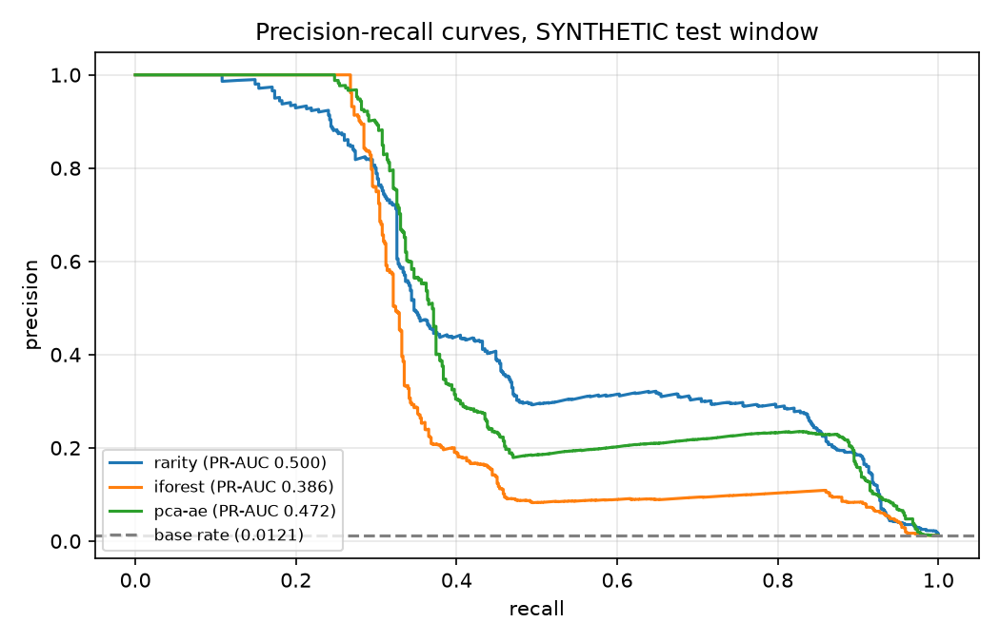
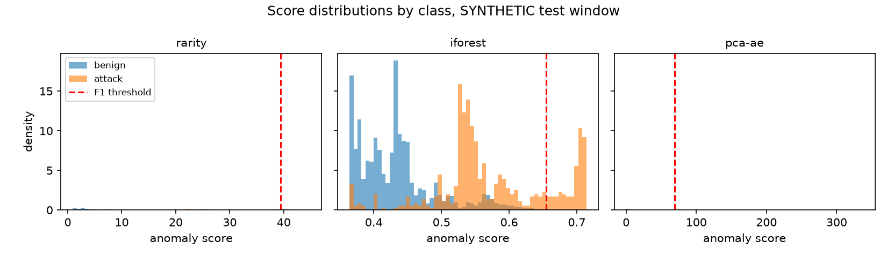
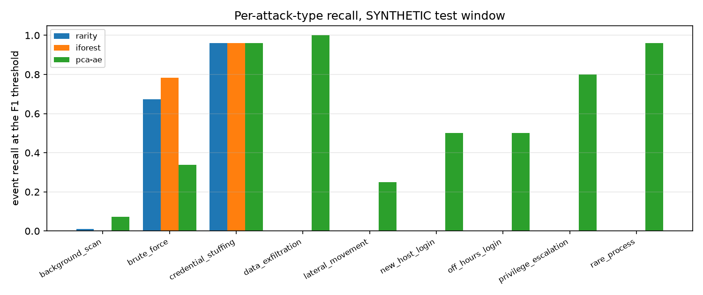
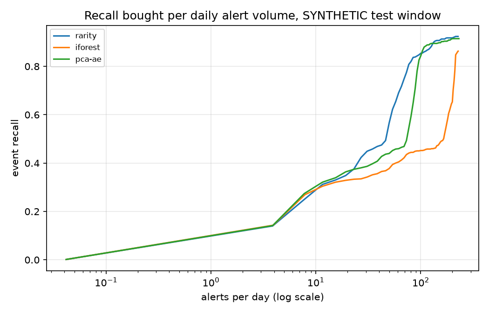

# Report: host-based log anomaly detection

**Every labelled number in this report comes from a SYNTHETIC corpus** generated
by this project (`log-anomaly synth`). The real Loghub corpora have no ground
truth, so on them we report only unsupervised quantities and a small manual
audit (§6). Synthetic results measure the *pipeline against the generator's
assumptions*; they are not evidence of detection capability against real
attackers. See [the design](docs/design.md) for the protocol, fixed in advance.

Reproduce everything below with:

```bash
uv run log-anomaly synth --out data/synthetic           # SYNTHETIC corpus
uv run log-anomaly download --dataset all               # real Loghub logs (optional)
uv run python scripts/make_report.py                    # numbers + charts
```

## 1. Setup

| | SYNTHETIC corpus |
| --- | --- |
| Events | 273,014 over 120 days (2024-03-04 → 2024-07-02), 6 hosts, 120 users |
| Split (by duration) | train 163,896 · validation 54,694 · test 54,424 |
| Test base rate | **1.21%** (657 attack events) |
| Models | `rarity` (statistical baseline) · `iforest` (Isolation Forest) · `pca-ae` (linear autoencoder) |
| Thresholds | chosen on validation only: F1-optimal, F5-optimal, and a fixed budget of 20 alerts/day |

Per-family base rates in the test window (SYNTHETIC). The families differ by
two orders of magnitude, which is the point: aggregate metrics are dominated
by the bursty families.

| Attack family | Test events | Share of test |
| --- | ---: | ---: |
| background_scan | 293 | 0.538% |
| brute_force | 180 | 0.331% |
| credential_stuffing | 50 | 0.092% |
| lateral_movement | 36 | 0.066% |
| new_host_login | 28 | 0.051% |
| rare_process | 25 | 0.046% |
| off_hours_login | 18 | 0.033% |
| data_exfiltration | 17 | 0.031% |
| privilege_escalation | 10 | 0.018% |

## 2. Headline results (SYNTHETIC)

| Model | PR-AUC | ROC-AUC | Precision @F1 | Recall @F1 | Alerts/day @F1 | Recall @20/day | Episode detection |
| --- | ---: | ---: | ---: | ---: | ---: | ---: | ---: |
| rarity | **0.500** | 0.962 | **0.860** | 0.262 | 8.3 | 0.335 | 0.04 |
| iforest | 0.386 | 0.915 | 0.836 | 0.288 | 9.4 | 0.329 | 0.02 |
| pca-ae | 0.472 | 0.951 | 0.767 | **0.321** | 11.5 | **0.344** | **0.53** |

Base rate 1.21%, so a PR-AUC of 0.50 is 41× the no-skill baseline — and still
means that at the F1 operating point roughly three quarters of attack *events*
are missed. ROC-AUC flatters all three models, as expected at this base rate.





The headline hides the more important result: **no model dominates, and the
choice depends on what you count.** `rarity` ranks best overall (PR-AUC) and
is the most precise. `pca-ae` is slightly worse on both, yet it detects 53% of
attack *episodes* against 4% and 2% for the others. The next section explains
why, and it is the central finding of this project.

## 3. Finding: event-level thresholds are blind to singleton attacks



At the F1 threshold, `rarity` and `iforest` catch brute force (0.67 / 0.78)
and credential stuffing (0.96) — and **nothing else**. Recall is exactly 0.00
for data exfiltration, rare process execution, new-host logins, off-hours
logins, privilege escalation and lateral movement. `pca-ae` catches some of
every family (0.25–1.00) and at least one event in nearly every
non-background-scan episode.

This is not missing signal. The median `rarity` score of a rare-process event
sits at the 94th percentile of benign events; exfiltration at the 99th. The
events *rank* as unusual; they do not rank above a threshold calibrated where
the bursts live. Two mechanisms combine:

1. **Score geometry.** A burst's 40th failure is extreme on six count features
   at once, so sum-of-surprise (and isolation depth) give it a far larger
   score than a singleton that is extreme on one feature. PCA reconstruction
   error behaves differently: a single feature far off the learned subspace
   produces a large error on its own.
2. **Threshold selection.** F1 over *events* is dominated by the families with
   the most events (background scan + brute force = 72% of test positives).
   The threshold that maximises event-F1 is a threshold for bursts.

Volume does not fix this cheaply. Moving to the F5 point lifts recall to
0.83–0.91 but costs 120–216 alerts/day. At a sustainable 20 alerts/day all
three models sit at recall ≈ 0.33–0.34.



The operational lesson: a single global threshold on a single score cannot
serve both bursty and singleton attack shapes. A production version of this
system would need per-family (or per-feature-group) thresholds, or a two-stage
triage where high-precision burst alerts and lower-volume singleton alerts are
budgeted separately. Reporting only aggregate precision/recall would have
hidden this entirely — `rarity`'s 0.86 precision looks like a good detector
until the per-family table shows it is only a brute-force detector.

## 4. Ablations (SYNTHETIC)

**Excluding background scanning from the measurement.** Background scan events
are single password probes, individually indistinguishable from a mistyped
password; every model recalls at most 7% of them. An operations team filters
this class upstream, so we report the variant where it is excluded from
*measurement* (it remains in training). Test base rate falls to 0.67%.

| Model | PR-AUC | Precision @F1 | Recall @F1 | Episode detection |
| --- | ---: | ---: | ---: | ---: |
| rarity | 0.596 | 0.858 | 0.464 | 0.05 |
| iforest | 0.589 | 0.886 | 0.514 | 0.05 |
| pca-ae | 0.604 | 0.854 | 0.497 | **0.99** |

**Clean-training oracle** (attack events removed from training — a setting no
deployment has; included only to price contamination). `pca-ae` PR-AUC rises
0.60 → 0.82 and `rarity` 0.60 → 0.66, so contamination of the training window
costs real ranking quality. `iforest` gets *worse* (0.59 → 0.39 PR-AUC): with
attacks removed, its isolation geometry ranks the remaining unusual benign
events above singleton attacks more often. We report this as observed; we did
not investigate it further, and it is a reason not to treat "cleaner training
data" as a universal remedy.

## 5. False positives and false negatives (SYNTHETIC, `pca-ae` @F1)

64 false positives in the 24-day test window (≈2.7/day of 11.5 alerts/day).
**All 64 are authentication failures**, and their mean feature contributions
are dominated by one feature: `auth_fail_count_zscore` (55.0, against 13.5 for
the next feature). Reading the top examples shows the mechanism: ordinary
users (`alice.adams`, `alice.clarke`, …) connecting from their usual internal
addresses who mistype their password several times in a row (the generator
labels exactly these benign). Their personal failure history is so quiet that
the per-user z-score denominator — their own historical standard deviation —
is tiny, so a small burst of typos becomes an extreme z-score. A pooled or floored variance (shrink the personal z-score toward the
population one until a user has enough history) would remove most of these
without touching real brute-force scores, whose counts are extreme in
absolute terms too. We did not implement this; it is the first fix we would
make.

446 false negatives: 272 background scans (§4 — accepted, filtered upstream),
119 of 180 brute-force events (the early attempts of each burst, before the
window counts accumulate; every brute-force *episode* is still detected, with
median detection delay 0s for `pca-ae` over detected episodes, 30s for
`iforest`, 76s for `rarity`), and 55 spread over lateral movement (27),
new-host (14) and off-hours logins (9) — the singleton families of §3, where
`pca-ae` at the 20/day budget still only reaches recall 0.25–0.50.

Example alerts (`rarity`, illustrative CLI output; model trained and scored on
the same SYNTHETIC file, so these scores are not evaluation numbers):

```
  1  score=62.16  2024-05-19 02:29:02+00:00  host05  auth_failure  user=dave.clarke  src=194.26.40.222
     reason: hour_profile_distance=7.93, off_hours=7.01, src_user_entropy_1h=6.43
  2  score=61.59  2024-03-07 23:35:32+00:00  host06  auth_failure  user=erin.diaz  src=194.26.19.179
     reason: src_user_entropy_1h=7.76, src_distinct_users_1h=7.72, off_hours=7.01
```

Both are credential-stuffing events, and the stated reasons (one source
spraying many accounts, at hours the accounts never use) are what an analyst
needs to act without reopening the log.

## 6. Real data (Loghub — no labels, nothing here is precision or recall)

The parser reads all three real corpora (100% of Linux and OpenSSH lines;
21,320/21,329 Proxifier lines). Two honest observations:

- **Each real corpus exercises exactly one feature family.** Linux and
  OpenSSH are authentication-only (the Linux log contains no `auth_success`
  records at all — 4,814 failures and 561 session opens among 19,631 `other`
  events); Proxifier is network-only. The multi-host, process-tree features
  are therefore demonstrated only on synthetic data.
- **`pca-ae` degenerates on Proxifier.** With only five varying features, a
  ≤10-component subspace reconstructs almost everything (scores ~1e-29); its
  ranking there is meaningless. `rarity` still ranks sensibly. Model choice
  must consider how many feature families a corpus actually carries.

OpenSSH context, for the base-rate point of §2: 182 successful logins against
505,314 failures over 28 days — successes are 0.036% of authentication events,
in a log where "successful login" is itself one of the rarest, most
interesting event classes.

**Manual audit (Linux, `rarity`, top 100 alerts in the test window).** Each
alert was read and classified as *malicious* (remote password guessing or
probing), *benign-but-unusual*, or *noise*. All 100 are bursts of remote
authentication failures against `root` or system accounts (`adm`, `ftp`,
`test`, `nobody`) — 100/100 malicious, Wilson 95% CI [0.963, 1.0]. They come
from only 22 distinct sources, so at episode level this is closer to 22/22,
CI [0.851, 1.0]: weaker than the event count suggests. The audit covers only
the head of the ranking; it says nothing about precision at depth or about
recall. Audited rows: [docs/audit_linux_top100.csv](docs/audit_linux_top100.csv).

## 7. Limitations

1. **All labelled evaluation is synthetic.** Attack families are injected
   independently of background traffic, at round, known rates, with labels on
   exactly the "evidence" events. Real intrusions are messier and adaptive.
   Treat every SYNTHETIC number as a regression test of the pipeline, not a
   capability claim.
2. **No labels on real data** — the audit in §6 is one reader, 100 events
   from 22 sources, head of one model's ranking on one corpus.
3. **Single-host real corpora**; per-host features are untested on real
   multi-host data. The LANL datasets would fix this but require registration
   (see design §2).
4. **Training contamination is priced only by oracle** (synthetic labels). On
   real data its size is unknown.
5. **No tuning**: no hyper-parameter search, no feature selection. Numbers are
   a floor for these model families, not a ceiling.
6. **The CLI resets feature state per file.** `score` on a one-hour log slice
   sees every user as new; it is designed for whole files, not streaming
   slices. A stateful scorer is future work.
7. **Log visibility only.** An attacker who avoids authentication, process and
   network logs — or stays inside a normal process tree — is invisible here
   by construction.
